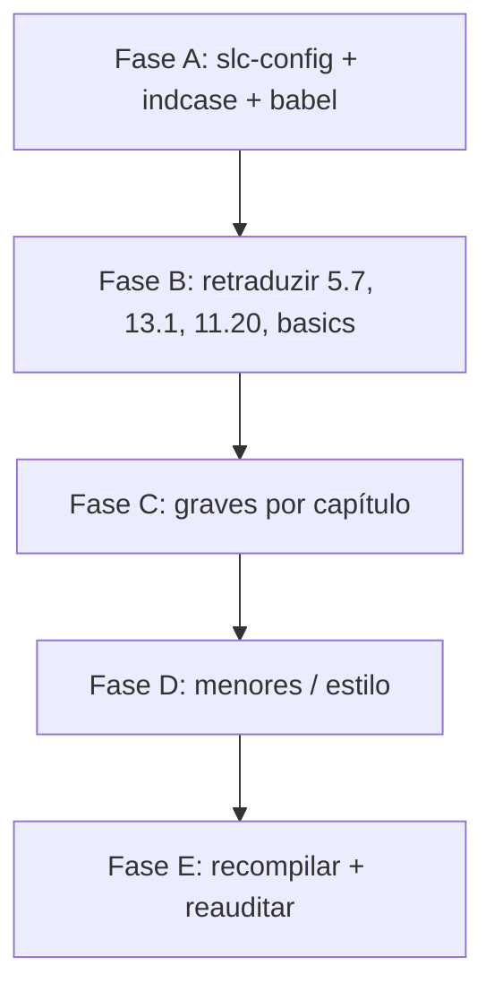

# Comparação qualitativa EN ↔ PT — Relatório mestre (curso SLC)

**Data:** 2026-07-01  
**Escopo:** Prefácio + caps. 1–15 + apêndices A–D do curso *Sets, Logic, and Computation*  
**PDFs:** `OpenLogic-original/.../slc-screen.pdf` (430 pp.) vs `OpenLogic-traduzido/.../slc-screen.pdf` (452 pp.)  
**Textos extraídos:** `verificacao/comparacao-pdf/` (19 pares + prefácio; ver `INDICE.md`)  
**Relatórios detalhados:** `relatorios/comparacao-qualidade/caps-00-04.md` … `caps-13-15-apendices.md`

---

## 1. Síntese executiva

A tradução do curso SLC **não está pronta para publicação como edição PT definitiva**, mas **não precisa de retradução global**. O trabalho restante é de **correção minuciosa ponto a ponto** — não de tradução automática em massa.

### Veredicto global

| Dimensão | Avaliação |
|----------|-----------|
| **Integridade formal** (LaTeX, prooftrees, tokens `!!{...}` vs. original) | **Excelente** — `scan_tokens.py` → 0 corrompidos |
| **Qualidade da prosa PT** | **Irregular** — de ~2,9/5 (cap. 3) a ~excelente (cap. 12) |
| **Inglês residual visível no PDF** | **Presente** — sobretudo caps. 3–4, 5.7, 9–11, 13, §14.9 |
| **Corrupção por tradutor externo** | **Localizada** — cap. 13 (§13.1), `substitution.tex` (§5.7) |
| **Infraestrutura LaTeX** | **Incompleta** — refs «section»/«part», macro `\indcase*`, glossário parcial em `slc-config.sty` |

### Notas por capítulo (auditoria manual)

| Cap. | Título PT | Nota | Estado |
|------|-----------|------|--------|
| 0 | Prefácio | 4,3 | Bom |
| 1 | Conjuntos | 3,8 | Bom (1 typo crítico) |
| 2 | Relações | 4,1 | Bom |
| 3 | Funções | **2,9** | **Insuficiente** (inglês residual sistemático) |
| 4 | O Tamanho dos Conjuntos | 3,2 | Fraco (herda tokens do cap. 3) |
| 5 | Introdução à Lógica de Primeira Ordem | 3,0 | Fraco (§5.7 crítica) |
| 6 | Sintaxe da Lógica de Primeira Ordem | 3,5 | Irregular (infra + título EN) |
| 7 | Semântica da Lógica de Primeira Ordem | 4,0 | Bom |
| 8 | Teorias e Seus Modelos | 4,2 | Bom |
| 9 | Sistemas de Derivação | ~3,8 | Bom com falhas |
| 10 | O Cálculo de Sequentes | ~4,3 | Muito bom |
| 11 | Dedução Natural | ~3,0 | **Irregular** (§11.20 em inglês) |
| 12 | O Teorema da Completude | ~4,8 | **Excelente** (referência de qualidade) |
| 13 | Além da lógica de primeira ordem | **Insuficiente** | **Crítico** |
| 14 | Computações de Máquinas de Turing | ~4,0 | Bom (§14.9 fraco) |
| 15 | Indecidibilidade | ~4,5 | Muito bom |
| A | Provas | ~4,5 | Muito bom |
| B | Indução | ~4,5 | Muito bom |
| C | Biografias | ~4,2 | Bom |
| D | O Alfabeto Grego | — | Não auditado em detalhe (tabela de símbolos; baixo risco) |

**Média ponderada aproximada:** ~3,7 / 5 — **utilizável em beta interno**, não como edição final.

### Contagem consolidada de achados (ação requerida)

| Severidade | Quantidade aprox. | Impacto |
|------------|-------------------|---------|
| **CRÍTICO** | 5 blocos / ficheiros | Quebram confiança ou sentido |
| **GRAVE** | ~25–30 | Inglês visível, omissões, terminologia errada |
| **MENOR** | ~40–50 | Typos, concordância, calcos |
| **ESTILO** | ~30+ | Polish; não bloqueia |

*(Contagens por capítulo nos relatórios de bloco; há sobreposição transversal — um fix em `slc-config.sty` resolve dezenas de ocorrências.)*

---

## 2. Metodologia

1. **Extração PDF por capítulo** — `scripts/extrair_pdf_por_capitulo.py` (PyMuPDF); um ficheiro `.txt` por capítulo EN e PT, demarcados por título no TOC (não espelho linha-a-linha).
2. **Auditoria manual** — quatro subagentes compararam **conteúdo semântico** EN ↔ PT + leitura do LaTeX fonte.
3. **Verificações automáticas auxiliares** — `scan_tokens.py` (integridade de tokens), contagem de prooftrees (caps. 9–12). **Diff automático não foi veredicto final.**
4. **Severidades** — ver `relatorios/comparacao-qualidade/README.md`.

**Princípio para correções futuras:** cada fix deve partir do **original inglês** (`OpenLogic-original/`), não de patch sobre texto já corrompido.

---

## 3. Problemas transversais (causa raiz)

Estes itens explicam **dezenas** de achados espalhados pelo PDF. Corrigi-los primeiro reduz o trabalho por capítulo.

### 3.1 Glossário incompleto em `slc-config.sty`

Tokens definidos só em inglês em `open-logic-config.sty` e **não** sobrescritos para PT:

| Token | Efeito no PDF PT | Caps. afetados |
|-------|------------------|----------------|
| `injection`, `surjection`, `bijection` | «a surjection», «Bijection», etc. | **3, 4**, FOL posterior |
| `derive` | «deriveda», «derives», «derive» | **5, 9, 10, 11** |
| `signed formula` | «signed formula» | **9** |
| `derivable` (expansão) | «!!{derivable}» cru no prefácio | **0** |

**Correção tipo:**
```latex
\settexttoken{injection}{injeção}{injeções}
\settexttoken{surjection}{sobrejeção}{sobrejeções}
\settexttoken{bijection}{bijecção}{bijecções}
\settexttoken{derive}{deriva}{derivam}
\settexttoken{signed formula}{fórmula assinada}{fórmulas assinadas}
```

### 3.2 Padrão `!!^a{adj} substantivo` (ordem inglesa)

Exemplos: `!!^a{surjective} função` → «A sobrejetora função»; `!!^a{structure}` com artigo manual → «Uma Uma estrutura».

**Regra:** usar `função !!{surjective}` ou `!!{surjective} função` **sem** `!!^a` quando o token já é adjetivo PT; **nunca** prefixar artigo manual antes de `!!a{...}` / `!!^a{...}`.

**Ficheiros:** `functions/function-kinds.tex`, `size-of-sets/enumerability.tex`, `introduction/satisfaction.tex`, `beyond/many-sorted-logic.tex`, `beyond/second-order-logic.tex`.

### 3.3 Macro `\indcase*` em inglês (`open-logic-config.sty` ~L1318)

Rótulos «$A$ **is atomic:**» aparecem no PDF do cap. 6 (e herdam no 7). Não passa pelo sistema de tokens.

**Correção:** localizar para `$#3$ é atômica:` (ou macro condicional por idioma no curso PT).

### 3.4 Referências cruzadas «section» / «part»

`\olref` renderiza «section 1.3», «part I» no PDF PT. LaTeX fonte está correto; falta **localização de build** (`babel` português ou `\renewcommand{\sectionname}{Seção}`, `\partname`, etc.).

**Caps. afetados:** 0–4 visivelmente; possivelmente todo o curso.

### 3.5 Terminologia inconsistente (política editorial)

| Conceito | Variantes no PT | Recomendação |
|----------|-----------------|--------------|
| `\Entails` / entailment | consequência **vs** implicada | **consequência de** $\Gamma$ |
| power set | conjunto das partes **vs** conjunto potência | **conjunto das partes** (alinhado a §1.2) |
| countable / enumerable | contável / enumerável | Manter token `enumerable`→contável; revisar títulos editoriais |

### 3.6 Corrupção por tradução automática externa

Ficheiros com prosa **mista EN/PT** ou duplicações — **retraduzir do original**, não patch superficial:

- `first-order-logic/beyond/introduction.tex` (cap. 13)
- `first-order-logic/beyond/beyond.tex` (editorial cap. 13)
- `first-order-logic/introduction/substitution.tex` (cap. 5, §5.7)

Ver `relatorios/02-integridade-tokens-corrupcao-externa.md`.

---

## 4. Achados críticos (bloqueiam publicação)

| ID | Local | Problema | Relatório |
|----|-------|----------|-----------|
| **K-01** | `sets/basics.tex` L12 | `{as}` → «considerada **as** um único objeto» | caps-00-04 |
| **K-02** | `open-logic-config.sty` `\indcase*` | «is atomic» no PDF | caps-05-08 |
| **K-03** | `introduction/substitution.tex` | Sec. 5.7 mista EN/PT, sentido errado («válido») | caps-05-08 |
| **K-04** | `natural-deduction/provability-propositional.tex` | **Sec. ~11.20 inteira em inglês** | caps-09-12 |
| **K-05** | `beyond/introduction.tex`, `beyond/beyond.tex` | Prosa corrompida (duplicações, truncamentos) | caps-13-15 |

---

## 5. Achados graves prioritários (amostra)

| ID | Local | Problema |
|----|-------|----------|
| G-01 | `slc-config.sty` | Tokens `injection`/`surjection`/`bijection` ausentes |
| G-02 | `slc-config.sty` | Token `derive` ausente |
| G-03 | `function-kinds.tex`, `enumerability.tex` | Ordem «sobrejetora função» + inglês residual |
| G-04 | `syntax-and-semantics/syntax-and-semantics.tex` | Título capítulo «Syntax and Semantics» |
| G-05 | `preface.tex` | «part I/II/III» no PDF |
| G-06 | `include/summary-1.tex` | X/Y em vez de A/B; «conjunto potência» |
| G-07 | `machines-computations/variants.tex` | Inglês residual, nota de rodapé errada (§14.9) |
| G-08 | `natural-deduction/rules-and-proofs.tex` L33 | «outros sequentes» (calco) |
| G-09 | Tableaux §9.4 | Rótulo «Assumption» |
| G-10 | `beyond/many-sorted-logic.tex`, `second-order-logic.tex` | `um !!a{domain}` → «um um domínio» |

Lista completa por capítulo nos quatro relatórios de bloco.

---

## 6. Pontos fortes (manter como referência)

- **Cap. 12** — prosa, prova de Henkin/Lindenbaum, terminologia: **padrão ouro** para o restante do curso.
- **Caps. 10, 14–15, Ap. A–B** — retraduções recentes de alta qualidade.
- **Prooftrees e sequentes** (caps. 9–12) — topologia e rótulos de regra **intactos**; 0 divergências estruturais.
- **Tokens estruturais FOL** — `cadeia`, `estrutura`, `fórmula`, `sentença`, `correção`, `completude`, `livre para`, etc.
- **Glossário** (`glossary.tex`) — alinhado ao config; não reauditado linha a linha nesta rodada.

---

## 7. Plano de correção (FASE 2 — não executar sem aprovação)

Este plano está **pronto para execução** quando o utilizador autorizar. Estimativa global: **3–5 dias de trabalho manual** concentrado (não automático), mais recompilações e rever PDF página a página nos trechos tocados.

### Fase A — Infraestrutura (1 sessão, alto retorno)

| # | Tarefa | Ficheiros | Esforço |
|---|--------|-----------|---------|
| A1 | Adicionar tokens `injection`, `surjection`, `bijection`, `derive`, `signed formula` | `slc-config.sty` | Baixo |
| A2 | Localizar `\indcase*` → «é atômica» | `open-logic-config.sty` ou override SLC | Baixo |
| A3 | Activar refs PT («Seção», «Parte») | `slc-screen.tex` / `babel` / `open-logic-config.sty` | Médio |
| A4 | Corrigir título cap. 6 | `syntax-and-semantics.tex` | Trivial |
| A5 | Unificar política «conjunto das partes» / «consequência» | `slc-config.sty`, grep no curso | Baixo |

**Critério de saída:** recompilar PDF; caps. 3–4 e 6 sem inglês óbvio de token/macro; refs legíveis em PT.

### Fase B — Conteúdo crítico (retradução manual)

| # | Tarefa | Fonte EN | Esforço |
|---|--------|----------|---------|
| B1 | Retraduzir §5.7 Substituição | `introduction/substitution.tex` | Médio |
| B2 | Retraduzir §13.1 + editorial cap. 13 | `beyond/introduction.tex`, `beyond.tex` | Médio |
| B3 | Traduzir §11.20 Provabilidade proposicional (ND) | `provability-propositional.tex` (modelo: sequent-calculus homólogo) | Médio |
| B4 | Fix `{as}` → «como» | `sets/basics.tex` L12 | Trivial |

**Critério de saída:** leitura integral das secções no PDF PT; zero parágrafos EN; sentido matemático conferido com original.

### Fase C — Graves por capítulo (edição pontual)

| Bloco | Acções principais |
|-------|-------------------|
| **0–1** | `preface.tex` partes; `summary-1.tex` A/B e power set |
| **3–4** | Reordenar captions `função !!{surjective}`; remover `um !!a{element}`; plural «contáveis» |
| **5–8** | Artigo duplicado `!!^a{structure}`; Γs inconsistentes; mereologia opcional |
| **9–11** | Tableau «Hipótese»; `rules-and-proofs.tex`; concordância descarga |
| **13** | Grep `um !!a{` / `uma !!a{` em todo `beyond/` |
| **14** | `variants.tex` L14–20, L33–38, nota L56–59 |

**Critério de saída:** grep manual + amostragem PDF por capítulo; relatórios de bloco reabertos só onde persistir GRAVE+.

### Fase D — Menores e estilo (polish)

- Concordâncias, calcos («garantido de ser», «perfeitamente»), redundâncias («adicionais adicionais»).
- Opcional: `e.g.` → «p.ex.»; «teoria de parte» → «mereologia».
- Ap. D: verificar cabeçalhos de colunas se necessário.

### Fase E — Verificação pós-correção

1. `python scripts/scan_tokens.py` → 0 corrompidos.
2. Recompilar `slc-screen.pdf`.
3. Reextrair PDF → `verificacao/comparacao-pdf/` (opcional diff).
4. **Reauditoria manual** dos caps. 3, 5, 11, 13 (os piores) + amostra 10% nos restantes.
5. Atualizar este relatório com estado «pós-correção».

---

## 8. Ordem de execução recomendada



**Não paralelizar** Fase B com tradutor automático em `OpenLogic-traduzido/`.

---

## 9. O que esta auditoria **não** cobriu

- **Ap. D** (alfabeto grego) — tabela; risco baixo.
- **Glossário** — confiança no relatório `backmatter-glossario.md`; sem releitura linha a linha.
- **Capa, front matter, metadados Taylor/ABOER** — traduzidos separadamente; fora do escopo PDF capítulo a capítulo.
- **`open-logic-complete.pdf`** — maior parte ainda EN; só subset SLC em PT.
- **Relatórios `relatorios/sec-*.md`** — histórico de tradução por seção; não substituem esta auditoria PDF.

---

## 10. Próximo passo (aguarda decisão do utilizador)

1. **Rever** este relatório e os quatro relatórios de bloco.
2. **Aprovar** o plano (Fases A–E) ou indicar prioridades (ex.: «só caps. 3 e 13 primeiro»).
3. **Só então** executar correções — uma fase de cada vez, com recompilação entre fases críticas.

---

## Anexos

| Documento | Conteúdo |
|-----------|----------|
| `verificacao/comparacao-pdf/INDICE.md` | Mapa capítulo → ficheiros EN/PT |
| `relatorios/comparacao-qualidade/caps-00-04.md` | Prefácio, caps. 1–4 |
| `relatorios/comparacao-qualidade/caps-05-08.md` | Caps. 5–8 (FOL) |
| `relatorios/comparacao-qualidade/caps-09-12.md` | Caps. 9–12 (provas) |
| `relatorios/comparacao-qualidade/caps-13-15-apendices.md` | Caps. 13–15, Ap. A–C |
| `relatorios/02-integridade-tokens-corrupcao-externa.md` | Risco de retradutor externo |
| `scripts/extrair_pdf_por_capitulo.py` | Extração usada nesta auditoria |

---

*Auditoria concluída em 2026-07-01. Correções não aplicadas — aguardando autorização para Fase 2.*
